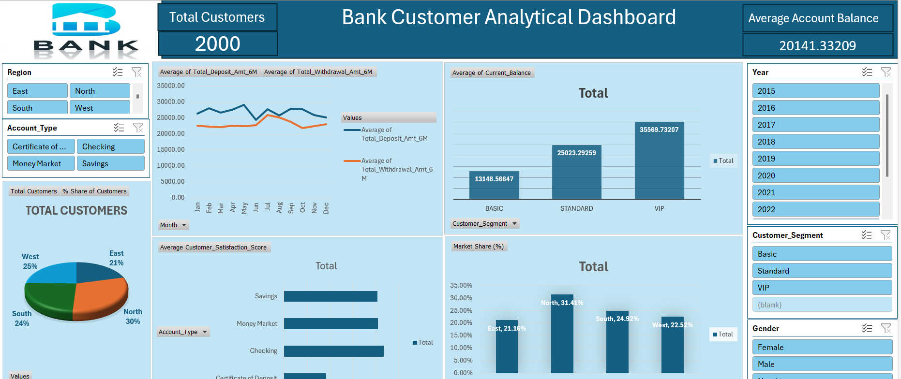

# Banking Operations & Customer Insights Dashboard Using Excel

An interactive **Excel Dashboard** designed to analyze banking data, track key performance indicators (KPIs), and uncover insights into customer demographics, account financial health, and transactional behavior.

**Project Overview**:
This repository contains a comprehensive Excel-based business intelligence solution that transforms raw, multi-source banking datasets into an actionable, executive-ready dashboard. The project enables branch managers and financial analysts to monitor portfolio health, track customer segmentation, and optimize retention strategies.

**Contents**:
1. **Data Sheet**: Contains raw  data including date, gender, Customer Segment, Account Type and Current Balance.
2. **Financial Health:**: Total Deposits, Average Account Balance, Customer Satisfaction Score.
3. **Average Balance Analysis**: Breaks down Current Balance data on a Sehgment basis with charts and graphs for visual analysis.
4. **Regional Analysis**: Analyzes the Market Share Using region.
5. **Customer Segmentation:**: Provides insights into customer demographics (Age, Income, Occupation).

**How to Use**:
1. **Download**: Download the Excel file from this repository.
2. **Data Input**: Input your own Banking data into the "Data Sheet" or replace existing data.
3. **Analysis**: Navigate through different sheets to analyze various aspects of Dataset.
4. **Charts**: Charts and graphs are dynamically linked to the data. Simply update the data, and the charts will update automatically.

**Requirements** : 

Microsoft Excel 

**Contributing**:

Contributions are welcome! If you have any suggestions for improving the analysis or adding new features, feel free to fork this repository, make your changes, and submit a pull request.

**Acknowledgments**:

- Inspiration: This analysis was inspired by the need for better understanding Banking Operations & Customer Insights and performance.
- Data Source:https://raw.githubusercontent.com/Bharti-khairnar/Banking-Dashboard/refs/heads/main/Banking_dashboard_dataset.xlsx

**Feedback**:

If you have any feedback, questions, or concerns, please feel free to open an issue in this repository or contact ME at bhartisonawane30@gmail.com.

Thank you for using Banking Dataset Analysis Excel! Enjoy analyzing your Banking data and discovering insights to improve your business.
